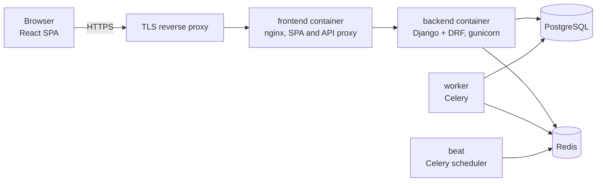

# CleanOps — case study

CleanOps is a multi-tenant operations, invoicing and client-portal platform
for a Dutch facility-services (cleaning) company. I built it on my own,
directing parallel AI coding agents, between May and November 2026.

**The source code is private** (it runs for a real client). This repository documents what was built and how. A code
walkthrough is available on request.

**Status:** production is not deployed yet. The system runs on an
acceptance/test environment.

## Who uses it

| Side | Roles | What they do |
|---|---|---|
| Provider (the cleaning company) | Super admin, company admin, building manager, staff | Manage customers, buildings and people; run tickets and extra work; plan recurring jobs; record hours; price, invoice and report |
| Client (the cleaning company's customers) | Customer company admin, location manager, user | Report issues, order or request quotes for extra work, approve finished work, read invoices and documents — only for their own organisation and the buildings they are granted |

## Feature map

- **Tickets** — issue reports with a role-gated state machine, staff
  assignment, completion evidence, customer approval, SLA warnings and
  escalation.
- **Extra work** — a cart of service lines. If every line has an agreed
  customer price it goes straight to operations; otherwise the provider
  sends a proposal the customer approves or rejects.
- **Planned work** — recurring jobs that generate dated occurrences and
  spawn tickets daily.
- **Contracts** — versioned agreed scope with gapless contract numbers and
  an invoice forecast.
- **Invoicing** — draft, issue, send; gapless numbering at send; credit
  notes by reversal; the PDF frozen at send.
- **Hours** — weekly timesheets with week locking and contracted-vs-worked
  comparison.
- **Client portal** — the customer's view of tickets, extra work, invoices
  and documents.
- **Reports, notifications, audit** — dashboards and exports, in-app and
  e-mail notifications in Dutch and English, and an audit log of every
  permission, role and scope change.

## Architecture

Backend: Django 5.2, Django REST Framework, PostgreSQL 16, Redis 7, Celery,
JWT auth. Frontend: React 19, TypeScript, Vite. Deployed as six Docker
Compose containers. Details: [docs/architecture.md](docs/architecture.md).

## Numbers

All measured from the private repository at its state of 12 November 2026,
or quoted from its own reports. Method and source for each:
[SOURCES.md](SOURCES.md).

| | |
|---|---|
| Backend Django apps | 16 |
| Database models (concrete) | 87 |
| API routes / route-method operations | 329 / 494 |
| Frontend page components / client routes | 74 / 77 |
| Backend tests run in CI (latest `main` run) | 6,177 |
| Frontend unit tests / end-to-end test blocks | 142 / 324 |
| CI backend shards | 13 |
| Full backend suite: one serial run → sharded CI | 5.9 h → about 15 min |
| Read endpoints probed per role (audit, Sep 2026) | 194 endpoints × 9 roles: 0 cross-tenant leaks, 0 server errors |
| State-machine attempts (same audit) | 354: 0 illegal transitions allowed |
| Commits / merged pull requests | 639 / 129 |

## How it was built

One developer (me) set scope, wrote the product rules and made every merge
decision. Implementation ran in parallel AI coding-agent sessions, each on
its own branch or worktree with a disjoint set of files. A second AI
session audited each pushed branch from the remote before merge, and the
full backend suite plus CI had to be green. Security rules are written as
numbered invariants, each tied to the tests that enforce it.
More: [docs/engineering-process.md](docs/engineering-process.md).

## Documentation

- [Architecture](docs/architecture.md) — apps, request path, background jobs, deployment
- [Access control](docs/access-control.md) — roles, tenant isolation, permission resolution, the endpoint probe
- [Domain model](docs/domain-model.md) — main entities and the state machines
- [Invoicing](docs/invoicing.md) — gapless numbering, credit notes, frozen PDFs
- [Testing and CI](docs/testing-and-ci.md) — suite size and the sharding story
- [Engineering process](docs/engineering-process.md) — working with parallel AI agents

## Author

Göktuğ Yıldırım — final-year BSc Artificial Intelligence student,
Vrije Universiteit Amsterdam.
goktugyildirim65@gmail.com · [linkedin.com/in/goktugyildirim1](https://linkedin.com/in/goktugyildirim1 · github.com/yildirimgoktug)

Documentation only; see [LICENSE](LICENSE).
