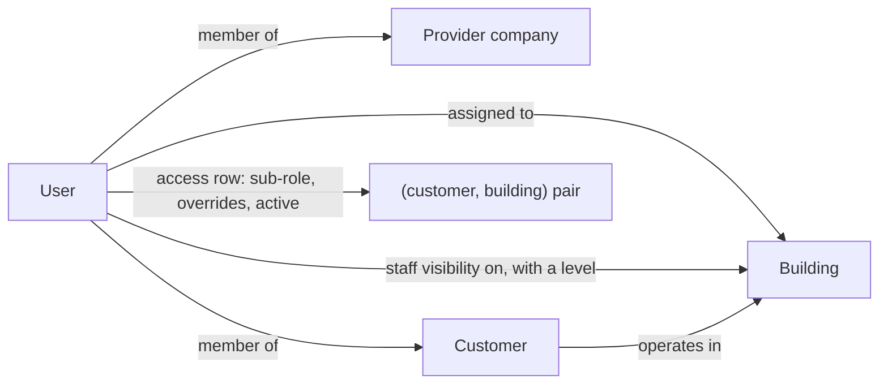

# Access control and tenant isolation

The rule the whole system is built around: a user sees and does only what
their role, their company, their buildings and their explicit permissions
allow. This page describes the model. It does not list endpoints or the
full permission matrix.

## Roles

There is one global role per user, with five values.

| Role | Side | Scope |
|---|---|---|
| Super admin | platform | everything |
| Company admin | provider | the provider companies they are a member of |
| Building manager | provider | the buildings they are assigned to |
| Staff | provider | work assigned to them, plus buildings they are given visibility on |
| Customer user | client | decided per customer and per building, see below |

The client-side hierarchy is **not** extra global roles. It lives on the
membership and access rows:

| Customer sub-role | Where it lives | Default reach |
|---|---|---|
| Customer company admin | a flag on the user's membership of that customer | every building of that customer, present and future |
| Location manager | an access row for one (customer, building) pair | everything at that building for that customer |
| User | an access row for one (customer, building) pair | only what they created there |

## Scoping dimensions



Visibility is decided along these dimensions:

1. **Provider company.** No provider ever sees another provider's data.
2. **Customer.** Customer-side access is keyed on the customer first, so two
   customers in the same building never see each other's records.
3. **Building.** Building managers and location managers are limited to
   their buildings. Staff visibility on a building has three levels:
   assigned work only, read the building, or read and request assignment.
4. **Ownership.** A plain customer user sees only records they created at
   their (customer, building) pairs.

Each dimension is implemented once, as a scoping function per resource
type (tickets, extra work, invoices, customers, buildings, …) that returns
a database queryset. Views start from that queryset, so an object outside
the user's scope is never loaded in the first place.

## How a permission resolves

There are two key namespaces: 13 provider-side keys (for example "assign
staff on this building") and 17 customer-side keys (for example "create a
ticket", "view tickets at this location", "approve extra work I
requested"). A customer-side key resolves per access row, in this order:

```text
# Illustrative pseudo-code, not the project's source
def customer_permission(access_row, key):
    if not access_row.active:
        return False                              # a disabled row grants nothing
    if key in access_row.overrides:
        return access_row.overrides[key]          # explicit grant or revoke for this user
    if customer_policy_denies(access_row.customer, key):
        return False                              # company-wide policy can only narrow
    return role_default(access_row.sub_role, key) # default for the sub-role
```

The company-wide customer policy can switch off whole families (for
example "customer users may not create extra work") but can never grant
something the role default does not already grant.

Two kinds of override are kept apart in code, data model and audit trail:

- **Permission override** — a lasting change to what one user may do.
- **Workflow override** — a one-off decision made by provider staff on the
  customer's behalf (for example approving work after a phone call). It
  needs a written reason and is stored on the status-history row.

## Gating the UI without trusting the UI

Detail responses include an `actions` block: booleans such as "may approve
now" or "may send this proposal", computed for the requesting user and the
record's current state by the same resolvers and state machines that guard
the write. The frontend uses them to show or hide controls. A request that
bypasses a hidden button gets the same refusal from the server.

## Invariants bound to tests

The security floor is written down as twelve numbered hard invariants in
the project's RBAC reference. Each row names the invariant, the code that
enforces it and the test that locks it. In plain words they say:

- No provider sees another provider's data; no customer sees another
  customer's data, even in a shared building.
- Customer users never see a whole building's data unless granted.
- Staff always see the work assigned to them, and cannot approve customer
  completion, pricing or overrides.
- Nobody can raise their own role or widen their own scope; only a super
  admin can create a customer company admin.
- Every permission, role or scope change is audit-logged, with a snapshot
  of the actor's own scope at the time.
- Permission overrides and workflow overrides are separate concepts.
- Committing an invoice (issue, send, un-issue, reverse) is a company-level
  act; building managers prepare drafts but cannot commit them.

A change that breaks one of these is treated as a release blocker, not a
bug to schedule. Supporting tests include parity tests proving that the
unified permission service gives exactly the same answer as the two
underlying resolvers for every key and every role, and cross-tenant tests
that try to reach another tenant's records by ID.

## The role-by-role probe

In September 2026 an end-to-end audit tested the running system from the
outside rather than relying on the unit tests. Two parts concern access:

**Read-endpoint probe.** 194 read (GET) endpoints were called as each of
nine role personas against seed data that contains a second provider
company and several customers, so that there is something to leak.
Responses were checked by content, not only by status code: a leak would
be any row belonging to a tenant the persona should not see.
Result: **0 cross-tenant leaks and 0 server errors.**

**State-machine probe.** 354 transition attempts were driven through the
real HTTP layer against the four guarded state machines (ticket, extra
work, proposal, invoice): 337 illegal moves and 17 legal ones, as super
admin and company admin. Everything ran inside one transaction that was
rolled back afterwards, and the rollback was verified by comparing record
counts before and after. Result: **0 illegal transitions allowed, 0 server
errors, and every refusal returned a readable message with a stable error
code.** The legal moves confirmed the probe exercised the real code
paths: an approval auto-closed its ticket, and sending an invoice
allocated its number inside the transaction.

These figures come from the audit report in the private repository and
describe the system at that date. They were not re-run for this case
study.
