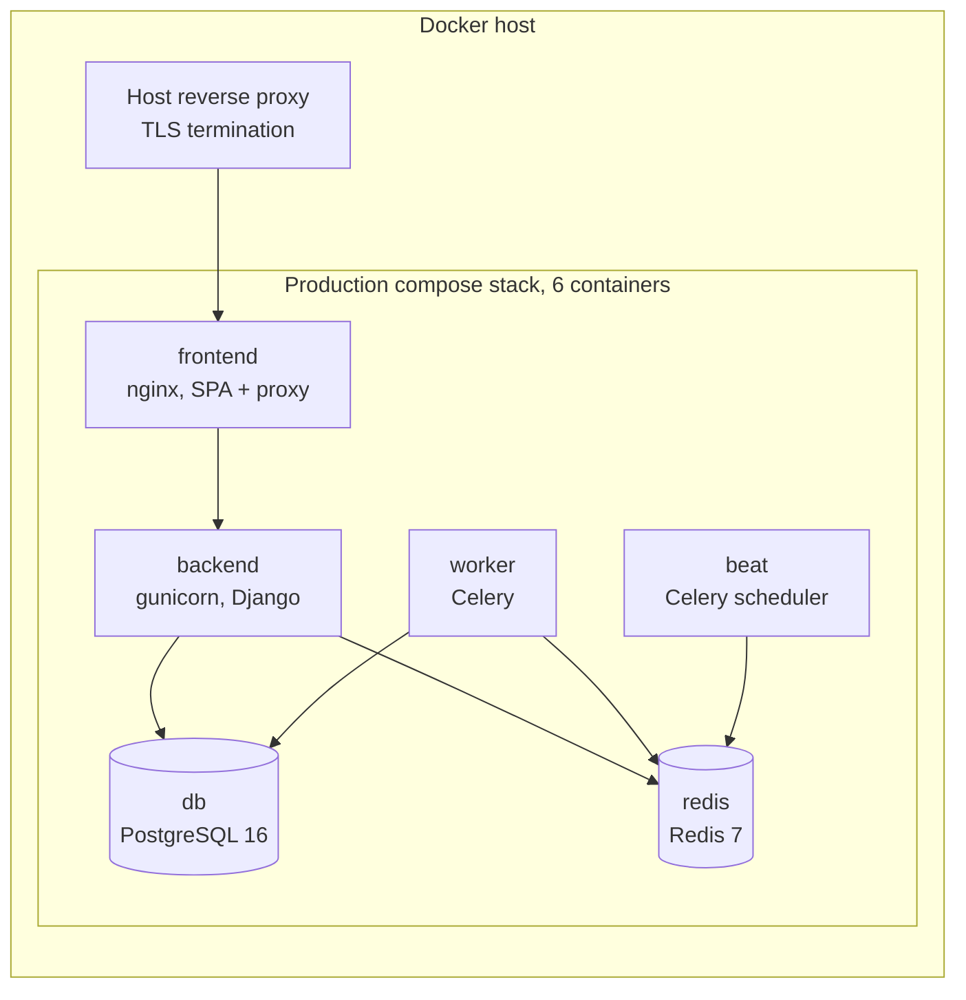

# Architecture

CleanOps is a Django REST API with a React single-page app in front of it,
PostgreSQL for data, Redis as the cache and message broker, and Celery for
background and scheduled work. Everything ships as Docker containers.

## Backend apps

The backend has 16 Django apps plus the project package (`config`), which
holds settings, URL routing, health checks, the production-settings
validator and shared PDF branding.

| App | Owns |
|---|---|
| `accounts` | Users and the five global roles, invitations, login logging, staff profiles and credentials, the provider-side permission resolver, the tenant-scoping helpers, the effective-permission composer |
| `companies` | Provider companies and who belongs to them |
| `buildings` | Buildings, building types, building-manager assignments, staff visibility per building, cost sharing between customers in one building |
| `customers` | Customer organisations, their buildings, their users and per-building access rows (with customer sub-role and permission overrides), the company-wide customer policy, contacts, departments and work-type labels |
| `tickets` | Tickets, their state machine, staff and manager assignment, sub-tasks, messages with visibility levels, attachments, the work plan, deadline reminders and late escalation |
| `extra_work` | Extra-work requests (a cart of service lines), the service catalogue, customer-specific agreed prices, proposals and their state machine, planned hours, final amounts, the billing rule for what is "earned" |
| `planned_work` | Recurring jobs, their time windows and the dated occurrences generated from them |
| `contracts` | Contracts, versioned revisions of agreed scope, gapless contract numbers, an invoice forecast and contract invoice generation |
| `invoicing` | Invoices and lines, gapless invoice numbering, the invoice lifecycle and reversals, frozen PDFs with a specification annex, the scheduled invoice run |
| `timesheets` | Time entries, hour and work types, contracted hours, week locking |
| `reports` | Operational, extra-work, hours and labour-cost reports and exports; hourly rates |
| `sla` | Business-hours SLA calculation, warning thresholds and warning sweeps |
| `notifications` | In-app notifications and inbox, e-mail delivery, per-user preferences, the Dutch/English message catalogue |
| `documents` | Customer document folders and files with access rules |
| `audit` | The audit log: who changed what, with a snapshot of the actor's scope at write time |
| `reviews` | Asking customers for a public review after they approve finished work, and the printable review card |

Module boundaries are deliberate. `timesheets` records how long someone
worked and has no link to tickets or extra work. `contracts` carries its
own prices and reaches into `invoicing` from exactly one module, which only
creates draft invoices.

## Request path

```mermaid
sequenceDiagram
    participant U as Browser (SPA)
    participant N as frontend nginx
    participant G as gunicorn / Django
    participant DB as PostgreSQL
    U->>N: HTTPS via reverse proxy, /api/...
    N->>G: proxy to backend
    G->>G: audit middleware records request context and actor scope
    G->>G: JWT authentication, then the view's permission class
    G->>DB: queryset narrowed by the tenant-scoping helper for this user
    G->>G: state machine (for transitions): role + scope check, row lock
    G->>DB: write in one transaction; audit rows via model signals
    G-->>U: JSON, incl. a per-record "actions" block for the UI
```

Points worth noting:

- **Scoping happens in the queryset**, before any object is loaded. A user
  outside the tenant gets "not found" or "forbidden", never another
  tenant's row.
- **Transitions only go through the state machine.** Each machine holds an
  explicit table of allowed moves and which roles may make them, and it
  locks the row (`select_for_update`) inside a transaction so a concurrent
  request sees the new status and is refused.
- **The UI does not decide permissions.** Detail responses carry an
  `actions` block (for example "may this viewer approve this record now")
  computed by the same code that guards the write. The frontend uses it to
  show or hide buttons; the server still enforces.

## Background and scheduled work

Celery runs with a separate worker and a beat scheduler. Scheduled jobs:

| Job | Cadence |
|---|---|
| Reconcile SLA states | every 5 minutes |
| Sweep SLA warnings | every 5 minutes |
| Late-ticket escalation | hourly |
| Generate planned occurrences and spawn tickets | daily |
| Invoice run (draft invoices for customers whose billing day is today) | daily |
| Deadline reminders | daily |
| SLA weekly summary | weekly |
| Billing-month-at-risk digest | weekly |

Each job is idempotent through data, not through a "did I run" flag. The
invoice run, for example, claims every piece of work it bills in the same
transaction that creates the draft, so a second run finds nothing left to
bill. E-mail sends retry with backoff, and warning and digest mails are
de-duplicated against the notification-log rows they already wrote.

## Deployment topology



- Only the frontend container has a published port, bound to the host's
  loopback interface; the reverse proxy in front of it owns TLS, redirects
  and HSTS. Backend, worker, beat, database and Redis are reachable only on
  the internal Docker network.
- The backend applies migrations and collects static files on start, then
  starts gunicorn.
- A settings validator refuses to start in production with placeholder
  secrets, wildcard hosts, a weak database password or missing CORS/CSRF
  settings.
- Database, Redis and uploaded media live on named volumes. Backups run
  daily (database dump and media), with an encrypted off-site copy and a
  documented restore drill.
- CI builds the backend and frontend images on every push to `main`.
- Error reporting (Sentry) is wired on both sides and stays inactive until
  configured, with personal data sending disabled.
