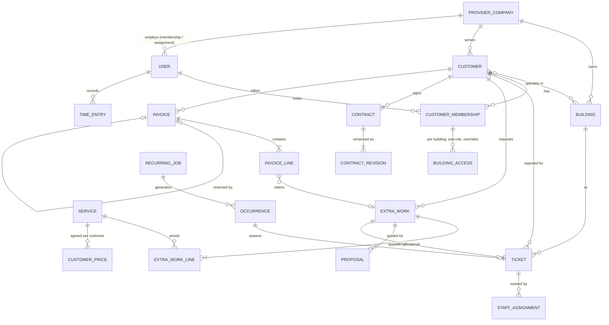
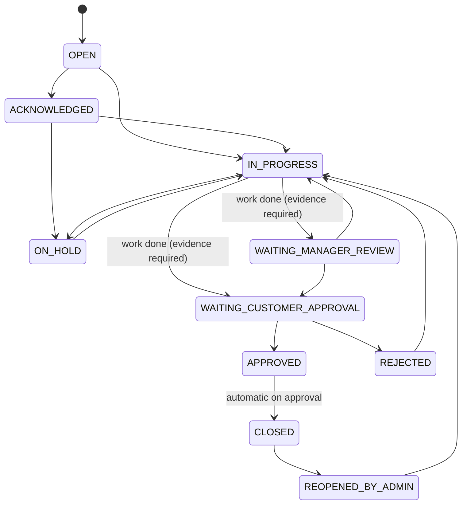
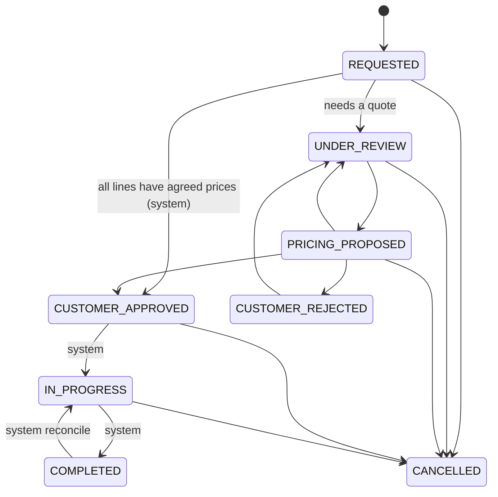
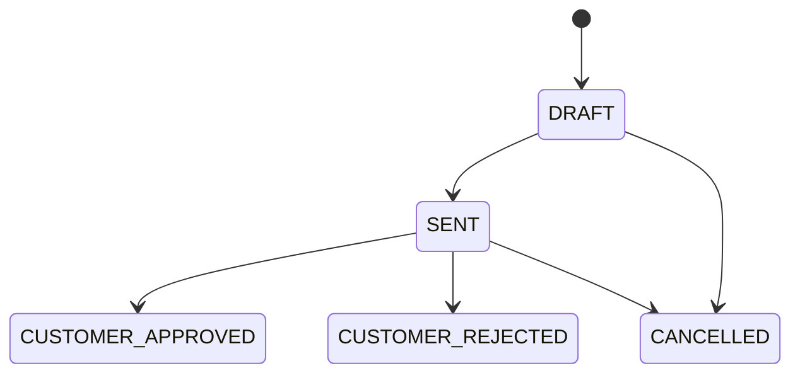
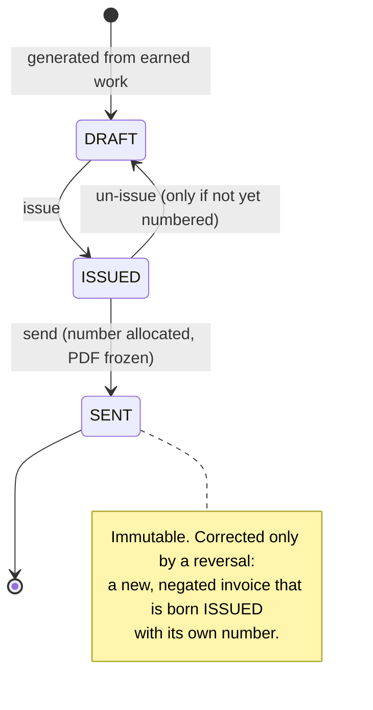

# Domain model

The database has 87 concrete models across 16 apps. The diagram below is
the conceptual core, not the full schema: join tables, history tables,
labels and settings are left out.

## Main entities

- **Provider company** — the cleaning company. The system is multi-tenant
  at this level; the test data deliberately contains a second provider.
- **Customer** — a client organisation of a provider, active in one or more
  buildings. A building can host several customers.
- **Ticket** — an issue report (complaint, request, report) at one building
  for one customer, worked by assigned staff.
- **Extra work** — work outside the regular scope, always a cart of one or
  more service lines. Approved work spawns one operational ticket per line.
- **Service and customer price** — a provider service catalogue plus
  per-customer agreed prices with validity dates. Prices are snapshotted
  onto lines so a later price change does not rewrite history.
- **Proposal** — the provider's quote for a cart that is not fully covered
  by agreed prices.
- **Recurring job and occurrence** — scheduled work that generates dated
  occurrences, each of which can spawn a ticket.
- **Contract** — recurring agreed scope (locations, lines, hours, money,
  billing rhythm). Changes are stored as revisions with an effective date,
  so a past period is billed at what was agreed then.
- **Invoice** — bills a customer's earned extra work and contract periods.
  See [invoicing.md](invoicing.md).
- **Time entry** — hours worked by an employee, independent of tickets.
- **Audit log** — field-level changes with actor, reason and a snapshot of
  the actor's scope.

## State machines

Every status change goes through a state machine that holds an explicit
table of allowed moves and the roles allowed to make each one. A move not
in the table is refused with a readable message and a stable error code.
Each accepted move writes a history row.

### Ticket

- Staff can start acknowledged work and mark their own work done, routed
  to manager review or straight to the customer depending on the building.
  They cannot approve, reject or put work on hold.
- Approval and rejection belong to the customer. When provider staff
  answer on the customer's behalf, it is recorded as a workflow override
  and needs a written reason.
- Only company admins and super admins can reopen a closed ticket.

### Extra work

- The route is decided once for the whole cart: if every line resolves to
  an agreed customer price, the request is approved like an order;
  if any line does not, the whole cart goes to a proposal.
- Once operational tickets exist, "is the work done?" is answered by those
  tickets only. The extra-work status follows them through system-only
  moves rather than being set by hand, so the two cannot disagree.
- Staff never see prices, proposals or commercial notes, only the
  operational tickets.

The proposal attached to an extra-work request has its own small machine:

A rejected proposal is replaced by a new draft, never moved backwards.

### Invoice

Details in [invoicing.md](invoicing.md).
