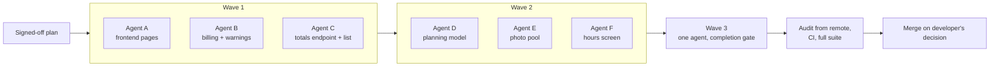

# Engineering process

CleanOps was built by one developer directing AI coding agents (Claude
Code). This page describes the working method as the project's own
planning documents record it.

## Division of labour

| Who | Does |
|---|---|
| Developer (me) | Product rules, scope of each sprint, sign-off on open decisions, approval of every migration, the decision to merge |
| Implementation agents (Claude Code sessions) | Build one scoped sprint each, on a branch or worktree, and report what was done and how it was verified |
| Audit agent (a separate Claude session) | Checks each pushed branch from the remote repository, not from the implementer's report, before it may merge |

## Written rules first

- **A source of truth for the product.** One document states what the
  system must be. Later addenda (invoicing, contracts, frontend redesign,
  stakeholder meetings) override it for the topics they cover. If the
  documents and the code disagree, the code is the truth, and the agent
  must report the drift instead of silently following either.
- **A decided plan per piece of work.** Larger efforts start from a plan
  with every open question answered and signed off, including a list of
  what is deliberately *not* built. Agents implement it; they do not
  reopen it.
- **A security floor.** Access rules are numbered invariants, each linked
  to the code that enforces it and the test that locks it
  ([access-control.md](access-control.md)). Breaking one is a release
  blocker.
- **A documentation index.** Every maintained document is listed in one
  index, in the same commit that creates it; anything unlisted is archived
  and not to be relied on.

## Running agents in parallel

Work is split into waves. Sprints within a wave **own disjoint sets of
files**, so they can run at the same time without conflicts; waves run in
sequence because each builds on the previous one's files. The example
below is the shape of the extra-work gap-closing plan.

Mechanics, as recorded in the plans:

- Each parallel agent works in its own git worktree and pushes to the
  shared sprint branch with pull-and-rebase. Because file ownership is
  disjoint the rebase is clean. Force-pushing is not allowed.
- Some sprints instead split across agents on separate branches, with one
  agent owning the sprint log and the others handing their entries to the
  integrator.
- Every agent session starts by syncing and running a check that proves it
  is on the right base commit, records the lint baseline, applies any new
  migration before testing the UI, and ends with an adversarial review of
  its own change.
- Commits stage files by explicit path. Migrations are additive and
  backward compatible, and each one needs the developer's approval.

The scale is visible in the history: 639 commits and 129 merged pull
requests between May and November 2026, and at one clean-up 99 finished
worktrees were removed from the development machine.

## Verification before merge

A sprint is not done because an agent says so. Before a merge:

1. The branch is pushed to the remote, so the audit agent can check out
   and verify the actual commit.
2. The CI result for that pushed commit is read: the sharded backend suite
   and the frontend type-check and build ([testing-and-ci.md](testing-and-ci.md)).
3. The full backend suite runs at the close of every sprint, not only the
   tests near the change.
4. Features are verified by reaching them as a user, starting from the
   navigation, on the test environment and for each affected role. An
   endpoint that answers proves a route exists, not that a feature does.
5. Any document that quotes on-screen text is checked against the running
   screen.
6. The merge happens only on the developer's decision. Tags mark restore
   points; at rest the remote holds only `main` and those tags.

## What the process learned

The planning documents record their own corrections. Three examples:

- A gate that ran only the test modules touched by a change let failures
  build up unseen in untouched modules. The rule became: full suite at
  every sprint close.
- The first CI shard plan missed a test directory that was not a Django
  app. The checker now derives coverage from the tree
  ([testing-and-ci.md](testing-and-ci.md#the-shard-plan-checker)).
- When five agents worked one sprint on five branches, the integration
  commit dropped the sprint's log entries. The entry was reconstructed
  from the commit history and marked as thinner than usual.
