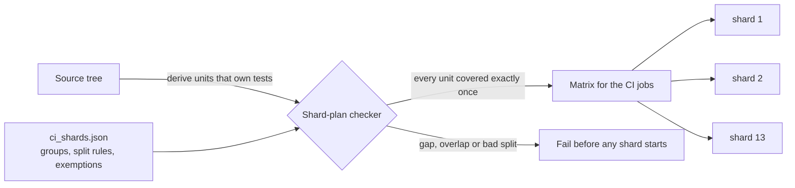

# Testing and CI

## Suite size

| Suite | Size |
|---|---|
| Backend (Django test runner, real PostgreSQL and Redis) | 6,169 test methods in 428 modules; 6,177 tests executed by CI on the latest `main` run |
| Frontend unit tests (Vitest) | 142 test blocks in 21 files |
| End-to-end and visual tests (Playwright) | 324 test blocks in 54 spec files; the last recorded full end-to-end run reported 401 passing tests in 1.1 h (some blocks run once per role or locale) |

CI also runs Django's system check, a check that no model change is
missing its migration, and the frontend type-check and production build.
The sprint conventions add an ESLint count that may not rise above a
recorded baseline and an audit that the Dutch and English translation
bundles have identical keys.

Backend tests run against PostgreSQL 16 and Redis 7 service containers,
not SQLite, so locking, constraints and transactions behave as in
production.

## The CI sharding story

**The problem.** The backend suite had grown to the point where a single
CI job could not finish. A full serial run in September 2026 took
**21,268 s (5.9 hours) for 6,077 tests**. The CI job, even with Django's
in-process parallelism, was killed by its 50-minute timeout at 50m22s,
so the required check could never go green.

**First step: 7 shards.** The suite was split across a matrix of jobs,
each running a group of apps with Django's `--parallel` inside it.

**Second step: 13 shards.** Shortly afterwards the repository was made
private, and the hosted runners went from 4 vCPUs to 2. That was found by
measurement: Django creates one test database per parallel worker, so
counting "Cloning test database" lines in a job log counts the runner's
cores. Two shards hit the 24-minute soft budget. The plan was re-tuned
from measured 2-vCPU times into 13 shards.

**Result.** The latest `main` run: 13 shards, longest shard 14m21s,
whole workflow 14m41s. Across the last eight green runs of the workflow
the total wall time was between 14m21s and 15m46s.

| Shard group | Shards | Tests in latest run |
|---|---|---|
| tickets | 3 | 1,289 |
| extra work | 2 | 1,458 |
| customers + accounts | 3 | 1,003 |
| SLA + notifications + planned work | 2 | 519 |
| reports + invoicing | 1 | 837 |
| timesheets + contracts + project config + reviews | 1 | 640 |
| buildings + audit + companies + documents | 1 | 431 |
| **Total** | **13** | **6,177** |

Each shard prints its own wall time and fails at a 24-minute soft budget
with a message that names the file to edit. A 40-minute job timeout
stays as the hard backstop.

## The shard-plan checker

Sharding adds a failure mode a single test command never had: **a test
directory missing from the plan is silently never run, and CI still
reports green.** So the plan is not trusted; it is checked.

- **One source.** A single JSON file defines the shard groups. The checker
  reads it and also emits the job matrix, so the workflow never keeps a
  second copy of the list.
- **Coverage is derived from the tree.** The unit of coverage is "a
  directory that owns a test file, or a test module at the backend root",
  not "a Django app". The first version asked "is this an app?" and missed
  the project package, which has no app config but owns 12 tests of the
  production-settings validator. The checker was changed to ask the
  question that matters.
- **Exemptions are explicit.** A unit that should not be sharded goes in
  an exempt list with a written reason, and every run prints it. Today the
  only one is a shared-fixtures module that contains no tests.
- **Splits are rules, not lists.** A large group declares
  `{"parts": N, "index": i}`; the checker sorts the group's test modules
  and deals them round-robin into buckets. A new test file joins a bucket
  the moment it exists, without anyone editing the plan. The checker
  proves the buckets tile the group exactly once, and refuses an app that
  appears in two groups.
- **Parity is measured.** After each change, the modules the plan would
  run were compared with Django's own test discovery: the same tests and
  modules on both sides, none missed, none run twice.
- **Negative-tested.** Dropping an app, duplicating one, a missing bucket,
  an app in two groups, and a test directory without app config each make
  the checker fail with the offending unit named.

Making the gate run on every push also surfaced a test that failed only on
Saturdays and Sundays, because it read the real calendar. The product was
correct; the test now pins the date, and the cross-week case it kept
hitting became a test of its own.

## Rules around the suite

- The full backend suite runs at the close of every sprint; a red test is
  a sprint item, not a note. This rule came from finding failures that had
  accumulated in modules no recent change had touched.
- Test runs are judged by the runner's textual `OK` / `FAILED` line.
- Any document that quotes a screen label is checked against the running
  screen, not only the translation file.
